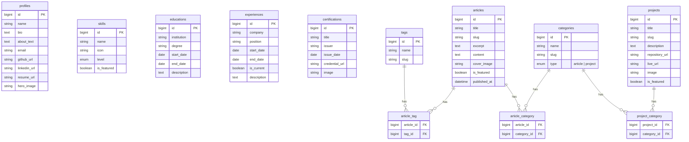

# Database

## Table Schema

| Nama Tabel | Kolom Utama | Keterangan / Relasi |
| :--- | :--- | :--- |
| profiles | id, name, bio, about_text, email, github_url, linkedin_url, resume_url, hero_image | single-row untuk profil utama & kontak. |
| skills | id, name, icon (SVG/class), level (enum/int), is_featured (boolean) | is_featured untuk memfilter data di landing page. |
| educations | id, institution, degree, start_date, end_date, description | Bisa diurutkan berdasarkan end_date DESC. |
| experiences | id, company, position, start_date, end_date, is_current, description | is_current (boolean) jika masih bekerja di sana. |
| certifications | id, title, issuer, issue_date, credential_url, image | |
| tags | id, name, slug | Khusus untuk Articles. |
| categories | id, name, slug, type (enum: 'article', 'project') | Master table untuk pengelompokan. |
| articles | id, title, slug, excerpt, content, cover_image, is_featured, published_at | is_featured untuk ditarik ke Home Page. |
| projects | id, title, slug, description, repository_url, live_url, image, is_featured | |
| article_tag (Pivot) | article_id, tag_id | Menghubungkan Articles dan Tags. |
| article_category (Pivot) | article_id, category_id | Validasi di backend: pastikan category_id memiliki type = 'article'. |
| project_category (Pivot) | project_id, category_id | Validasi di backend: pastikan category_id memiliki type = 'project'. |

## Diagram ER

