# Database Schema & Architecture Specification
## Web Portofolio Personal — M FAUZAN HANIF

---

## 1. Ikhtisar Arsitektur Basis Data

Sistem menggunakan database relasional (**MySQL 8.0+ / MariaDB**) yang dirancang untuk mendukung performa cepat pada landing page publik serta integritas relasional pada modul CMS.

### Konvensi & Standar:
- **Primary Keys:** `id` (`BIGINT UNSIGNED AUTO_INCREMENT`).
- **Timestamps:** Seluruh tabel entitas memiliki `created_at` dan `updated_at` (`TIMESTAMP NULL`).
- **Integritas Referensial:** Semua tabel pivot menggunakan foreign key constraint dengan `ON DELETE CASCADE`.
- **Strategi Penyimpanan Media:** Gambar/media disimpan ke disk `public` langsung (misal: `public/uploads/...`) agar kompatibel dengan shared hosting cPanel tanpa memerlukan symlink (`storage:link`).
- **Deployment-Friendly:** Struktur tabel mudah diekspor/diimpor via file SQL di phpMyAdmin.

---

## 2. Definisi Enums

```php
// app/Enums/CategoryType.php
namespace App\Enums;

enum CategoryType: string
{
    case Article = 'article';
    case Project = 'project';
}

// app/Enums/ArticleStatus.php
namespace App\Enums;

enum ArticleStatus: string
{
    case Draft = 'draft';
    case Published = 'published';
}
```

---

## 3. Rincian Skema Tabel

### 3.1. Tabel `users` (Admin Authentication)
Menyimpan akun admin untuk autentikasi CMS melalui Laravel Fortify.

| Kolom | Tipe Data | Modifiers | Keterangan |
| :--- | :--- | :--- | :--- |
| `id` | `BIGINT UNSIGNED` | PK, Auto Increment | Identitas unik user |
| `name` | `VARCHAR(255)` | Not Null | Nama admin |
| `email` | `VARCHAR(255)` | Unique, Not Null | Email login |
| `password` | `VARCHAR(255)` | Not Null | Hash kata sandi |
| `remember_token`| `VARCHAR(100)` | Nullable | Token remember-me |
| `created_at` | `TIMESTAMP` | Nullable | Waktu registrasi |
| `updated_at` | `TIMESTAMP` | Nullable | Waktu pembaruan |

---

### 3.2. Tabel `profiles` (Data Profil & Kontak)
Menyimpan data identitas diri utama pemilik portofolio (M FAUZAN HANIF).

| Kolom | Tipe Data | Modifiers | Keterangan |
| :--- | :--- | :--- | :--- |
| `id` | `BIGINT UNSIGNED` | PK, Auto Increment | Identitas profil |
| `name` | `VARCHAR(255)` | Not Null | Nama lengkap pemilik |
| `headline` | `VARCHAR(255)` | Nullable | Jabatan / tagline singkat (mis: "Software Engineer") |
| `about` | `TEXT` | Nullable | Cerita singkat tentang diri dan fokus keahlian |
| `photo` | `VARCHAR(255)` | Nullable | Path / nama file foto profil |
| `email` | `VARCHAR(255)` | Not Null | Email kontak resmi |
| `sosmed` | `JSON` | Nullable | Objek JSON tautan media sosial fleksibel (`github`, `linkedin`, `instagram`, `x`, dll) |
| `created_at` | `TIMESTAMP` | Nullable | |
| `updated_at` | `TIMESTAMP` | Nullable | |

---

### 3.3. Tabel `categories`
Master kategori untuk mengelompokkan proyek maupun artikel (polimorfik sederhana via kolom `type`).

| Kolom | Tipe Data | Modifiers | Keterangan |
| :--- | :--- | :--- | :--- |
| `id` | `BIGINT UNSIGNED` | PK, Auto Increment | Identitas kategori |
| `name` | `VARCHAR(255)` | Not Null | Nama kategori (mis: "Web Development", "Backend") |
| `slug` | `VARCHAR(255)` | Unique, Not Null | URL slug unik |
| `type` | `ENUM` | Index, Not Null | `'article'` atau `'project'` |
| `created_at` | `TIMESTAMP` | Nullable | |
| `updated_at` | `TIMESTAMP` | Nullable | |

---

### 3.4. Tabel `tags`
Master kata kunci/tag khusus untuk artikel.

| Kolom | Tipe Data | Modifiers | Keterangan |
| :--- | :--- | :--- | :--- |
| `id` | `BIGINT UNSIGNED` | PK, Auto Increment | Identitas tag |
| `name` | `VARCHAR(255)` | Not Null | Nama tag (mis: "Laravel", "React", "Tutorial") |
| `slug` | `VARCHAR(255)` | Unique, Not Null | URL slug unik |
| `created_at` | `TIMESTAMP` | Nullable | |
| `updated_at` | `TIMESTAMP` | Nullable | |

---

### 3.5. Tabel `articles`
Konten artikel teknis atau blog pribadi.

| Kolom | Tipe Data | Modifiers | Keterangan |
| :--- | :--- | :--- | :--- |
| `id` | `BIGINT UNSIGNED` | PK, Auto Increment | Identitas artikel |
| `title` | `VARCHAR(255)` | Not Null | Judul artikel |
| `slug` | `VARCHAR(255)` | Unique, Not Null | URL slug artikel |
| `excerpt` | `TEXT` | Nullable | Ringkasan singkat untuk kartu preview |
| `content` | `LONGTEXT` | Not Null | Isi artikel lengkap (HTML hasil editor WYSIWYG) |
| `cover_image` | `VARCHAR(255)` | Nullable | Path gambar sampul artikel |
| `status` | `ENUM` | Index, Default: `'draft'` | `'draft'` atau `'published'` |
| `is_featured` | `BOOLEAN` | Default: `false`, Index | Tampilkan di Featured Articles landing page |
| `published_at` | `TIMESTAMP` | Nullable, Index | Tanggal terbit artikel |
| `created_at` | `TIMESTAMP` | Nullable | |
| `updated_at` | `TIMESTAMP` | Nullable | |

---

### 3.6. Tabel `projects`
Daftar karya dan portofolio proyek perangkat lunak.

| Kolom | Tipe Data | Modifiers | Keterangan |
| :--- | :--- | :--- | :--- |
| `id` | `BIGINT UNSIGNED` | PK, Auto Increment | Identitas proyek |
| `title` | `VARCHAR(255)` | Not Null | Nama/judul proyek |
| `slug` | `VARCHAR(255)` | Unique, Not Null | URL slug proyek |
| `description` | `TEXT` | Not Null | Penjelasan proyek, fitur, dan arsitektur |
| `tech_stack` | `JSON` | Nullable | Daftar teknologi yang dipakai (array string) |
| `image` | `VARCHAR(255)` | Nullable | Path gambar sampul/screenshot proyek |
| `project_url` | `VARCHAR(255)` | Nullable | Tautan ke live demo atau repositori kode |
| `is_featured` | `BOOLEAN` | Default: `false`, Index | Tampilkan di Featured Projects landing page |
| `created_at` | `TIMESTAMP` | Nullable | |
| `updated_at` | `TIMESTAMP` | Nullable | |

---

### 3.7. Tabel `skills`
Daftar keahlian teknis beserta kelompok dan tingkat kemahirannya.

| Kolom | Tipe Data | Modifiers | Keterangan |
| :--- | :--- | :--- | :--- |
| `id` | `BIGINT UNSIGNED` | PK, Auto Increment | Identitas skill |
| `name` | `VARCHAR(255)` | Not Null | Nama keahlian (mis: "PHP", "React", "Docker") |
| `category` | `VARCHAR(255)` | Index, Nullable | Pengelompokan bidang (mis: "Backend", "Frontend") |
| `level` | `VARCHAR(50)` | Nullable | Tingkat kemahiran (mis: "Advanced", "Expert", atau 1-5) |
| `icon` | `VARCHAR(255)` | Nullable | Ikon keahlian (nama ikon Lucide atau SVG) |
| `is_featured` | `BOOLEAN` | Default: `false`, Index | Tampilkan di Featured Skills landing page |
| `created_at` | `TIMESTAMP` | Nullable | |
| `updated_at` | `TIMESTAMP` | Nullable | |

---

### 3.8. Tabel `educations`
Riwayat pendidikan formal, kursus intensif, atau sertifikasi akademik.

| Kolom | Tipe Data | Modifiers | Keterangan |
| :--- | :--- | :--- | :--- |
| `id` | `BIGINT UNSIGNED` | PK, Auto Increment | Identitas pendidikan |
| `institution` | `VARCHAR(255)` | Not Null | Nama institusi pendidikan |
| `degree` | `VARCHAR(255)` | Not Null | Jenjang / jurusan studi |
| `start_year` | `INT` | Not Null | Tahun mulai |
| `end_year` | `INT` | Nullable, Index | Tahun selesai (null jika masih berjalan) |
| `description` | `TEXT` | Nullable | Keterangan prestasi, fokus studi, dsb |
| `created_at` | `TIMESTAMP` | Nullable | |
| `updated_at` | `TIMESTAMP` | Nullable | |

---

### 3.9. Tabel `experiences`
Riwayat pengalaman kerja, magang, atau kepemimpinan profesional.

| Kolom | Tipe Data | Modifiers | Keterangan |
| :--- | :--- | :--- | :--- |
| `id` | `BIGINT UNSIGNED` | PK, Auto Increment | Identitas pengalaman |
| `company` | `VARCHAR(255)` | Not Null | Nama perusahaan atau organisasi |
| `role` | `VARCHAR(255)` | Not Null | Posisi atau peran yang diemban |
| `start_date` | `DATE` | Not Null, Index | Tanggal mulai bekerja |
| `end_date` | `DATE` | Nullable | Tanggal selesai (null jika saat ini masih aktif) |
| `description` | `TEXT` | Nullable | Deskripsi tanggung jawab, pencapaian, dan teknologi |
| `created_at` | `TIMESTAMP` | Nullable | |
| `updated_at` | `TIMESTAMP` | Nullable | |

---

### 3.10. Tabel `certifications`
Bukti sertifikasi kompetensi dan lisensi profesional.

| Kolom | Tipe Data | Modifiers | Keterangan |
| :--- | :--- | :--- | :--- |
| `id` | `BIGINT UNSIGNED` | PK, Auto Increment | Identitas sertifikat |
| `name` | `VARCHAR(255)` | Not Null | Nama sertifikat |
| `issuer` | `VARCHAR(255)` | Not Null | Lembaga penerbit (mis: "AWS", "Google Cloud") |
| `issued_at` | `DATE` | Not Null, Index | Tanggal terbit sertifikat |
| `image` | `VARCHAR(255)` | Nullable | Path gambar/bukti sertifikat |
| `credential_url`| `VARCHAR(255)` | Nullable | Tautan verifikasi kredensial online |
| `created_at` | `TIMESTAMP` | Nullable | |
| `updated_at` | `TIMESTAMP` | Nullable | |

---

### 3.11. Tabel Pivot (Many-to-Many Relationships)

#### Tabel `article_category`
Menghubungkan artikel dengan kategorinya (`type = 'article'`).
- `article_id` (`BIGINT UNSIGNED`, FK → `articles.id`, `ON DELETE CASCADE`)
- `category_id` (`BIGINT UNSIGNED`, FK → `categories.id`, `ON DELETE CASCADE`)
- **Primary Key Komposit:** `(article_id, category_id)`

#### Tabel `project_category`
Menghubungkan proyek dengan kategorinya (`type = 'project'`).
- `project_id` (`BIGINT UNSIGNED`, FK → `projects.id`, `ON DELETE CASCADE`)
- `category_id` (`BIGINT UNSIGNED`, FK → `categories.id`, `ON DELETE CASCADE`)
- **Primary Key Komposit:** `(project_id, category_id)`

#### Tabel `article_tag`
Menghubungkan artikel dengan tag kata kunci.
- `article_id` (`BIGINT UNSIGNED`, FK → `articles.id`, `ON DELETE CASCADE`)
- `tag_id` (`BIGINT UNSIGNED`, FK → `tags.id`, `ON DELETE CASCADE`)
- **Primary Key Komposit:** `(article_id, tag_id)`

---

## 4. Diagram Relasi Entitas (Mermaid ERD)

```mermaid
erDiagram
    users {
        bigint id PK
        string name
        string email UK
        string password
        timestamp created_at
        timestamp updated_at
    }

    profiles {
        bigint id PK
        string name
        string headline
        text about
        string photo
        string email
        json sosmed
        timestamp created_at
        timestamp updated_at
    }

    skills {
        bigint id PK
        string name
        string category
        string level
        string icon
        boolean is_featured
        timestamp created_at
        timestamp updated_at
    }

    educations {
        bigint id PK
        string institution
        string degree
        int start_year
        int end_year
        text description
        timestamp created_at
        timestamp updated_at
    }

    experiences {
        bigint id PK
        string company
        string role
        date start_date
        date end_date
        text description
        timestamp created_at
        timestamp updated_at
    }

    certifications {
        bigint id PK
        string name
        string issuer
        date issued_at
        string image
        string credential_url
        timestamp created_at
        timestamp updated_at
    }

    categories {
        bigint id PK
        string name
        string slug UK
        enum type "article | project"
        timestamp created_at
        timestamp updated_at
    }

    tags {
        bigint id PK
        string name
        string slug UK
        timestamp created_at
        timestamp updated_at
    }

    articles {
        bigint id PK
        string title
        string slug UK
        text excerpt
        longtext content
        string cover_image
        enum status "draft | published"
        boolean is_featured
        timestamp published_at
        timestamp created_at
        timestamp updated_at
    }

    projects {
        bigint id PK
        string title
        string slug UK
        text description
        json tech_stack
        string image
        string project_url
        boolean is_featured
        timestamp created_at
        timestamp updated_at
    }

    article_category {
        bigint article_id PK,FK
        bigint category_id PK,FK
    }

    project_category {
        bigint project_id PK,FK
        bigint category_id PK,FK
    }

    article_tag {
        bigint article_id PK,FK
        bigint tag_id PK,FK
    }

    articles ||--o{ article_category : "categorized_by"
    categories ||--o{ article_category : "applied_to_article"

    projects ||--o{ project_category : "categorized_by"
    categories ||--o{ project_category : "applied_to_project"

    articles ||--o{ article_tag : "tagged_with"
    tags ||--o{ article_tag : "applied_to_article"
```



---

## 5. Eloquent Model Casting

```php
// Profile Model
protected $casts = [
    'sosmed' => 'array',
];

// Project Model
protected $casts = [
    'tech_stack' => 'array',
    'is_featured' => 'boolean',
];

// Article Model
protected $casts = [
    'status' => ArticleStatus::class,
    'is_featured' => 'boolean',
    'published_at' => 'datetime',
];

// Category Model
protected $casts = [
    'type' => CategoryType::class,
];

// Skill Model
protected $casts = [
    'is_featured' => 'boolean',
];

// Education Model
protected $casts = [
    'start_year' => 'integer',
    'end_year' => 'integer',
];

// Experience Model
protected $casts = [
    'start_date' => 'date',
    'end_date' => 'date',
];

// Certification Model
protected $casts = [
    'issued_at' => 'date',
];
```
