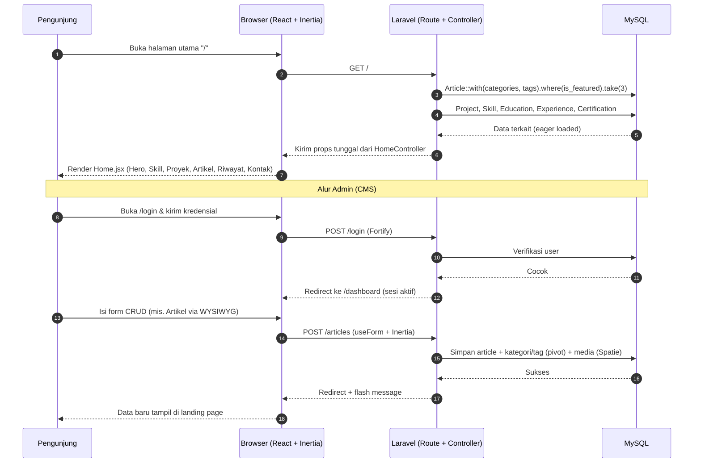
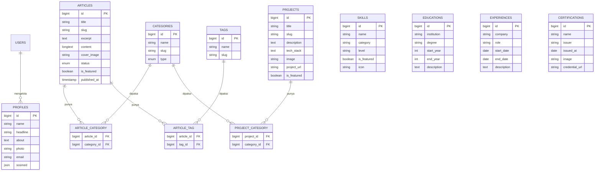

# PRD — Project Requirements Document

## 1. Overview

**Masalah yang diselesaikan**
Saat ini M FAUZAN HANIF belum memiliki satu tempat resmi yang menampilkan identitas profesionalnya sebagai software engineer. Rekruter, klien, atau kolega harus mencari informasi tersebar di LinkedIn, GitHub, dan CV terpisah untuk mengenal kemampuan, karya, dan pengalaman Anda.

**Tujuan utama aplikasi**
Membangun **web portofolio pribadi** yang:
- Menampilkan profil, foto, dan cara menghubungi Anda secara langsung di halaman depan.
- Memamerkan proyek, skill, artikel, riwayat pendidikan, pengalaman kerja, serta sertifikat dalam satu situs yang rapi dan profesional.
- Memberi Anda **CMS (Content Management System)** pribadi agar bisa memperbarui seluruh konten sendiri tanpa menyentuh kode.
- Menjadi bukti nyata (*proof of work*) bahwa Anda seorang software engineer yang mampu membangun aplikasi full-stack modern (Laravel + React + MySQL).

**Pengguna utama:** Anda sendiri sebagai pemilik & admin konten, serta pengunjung (rekruter, klien, sesama developer) sebagai pembaca.

---

## 2. Requirements

**Fungsional**
1. Halaman publik (landing page) berisi bagian: Hero/About, Featured Skills, Featured Project, Featured Article, Education, Experiences, Certification, dan Contact.
2. Halaman autentikasi (`/login`) khusus admin menggunakan Laravel Fortify.
3. CMS/dashboard terproteksi yang hanya bisa diakses setelah login.
4. CRUD lengkap untuk: Tag, Kategori, Artikel, Proyek, Skill, Pendidikan, Pengalaman, Sertifikat, dan Profil (termasuk kontak).
5. Editor teks kaya (WYSIWYG) pada kolom `content` artikel, menghasilkan HTML yang tersimpan di database.
6. Upload gambar untuk foto profil, sampul proyek, gambar sertifikat, dan gambar di dalam artikel.
7. Relasi kategori bersifat polimorfik-sederhana: satu tabel `categories` dengan kolom `type` (enum: `article`, `project`) + tabel pivot, sehingga kategori bisa dipakai oleh artikel maupun proyek. Tag hanya dipakai khusus untuk artikel.

**Non-fungsional**
1. Halaman landing page harus ringan — data diambil dengan *eager loading* (`with()`) dan dibatasi jumlahnya (misal `.take(3)` untuk konten unggulan).
2. Data dikirim dari Laravel ke React sebagai props tunggal melalui Inertia.js.
3. Tampilan responsif (mobile & desktop) dan rapi.
4. Keamanan: halaman CMS hanya bisa diakses setelah autentikasi berhasil.

**Batasan**
- Tech stack: Laravel 13 + React (Inertia starter kit) + MySQL.
- Deployment: **shared hosting (cPanel) tanpa Node.js dan tanpa akses SSH**. Build aset React/Vite dilakukan di komputer lokal, server hanya menjalankan PHP + MySQL.
- Media/gambar disimpan langsung di disk `public` aplikasi (mis. `public/uploads/...`) agar tidak memerlukan `php artisan storage:link` maupun symlink.
- Migrasi & seed database dijalankan tanpa terminal: import file SQL melalui phpMyAdmin (Cron Jobs cPanel hanya dipakai bila diperlukan).

---

## 3. Core Features

Fitur di bawah ini disusun mengikuti **Kerangka Fitur (Roadmap)** yang telah disetujui.

### Fase 1 — Fondasi Portofolio & Personal Branding
**1. Beranda & Perkenalan (high)**
- **Hero Foto & Perkenalan** — Tampilan pembuka berisi foto, nama, dan kalimat singkat tentang diri Anda.
- **Section Tentang Saya** — Cerita singkat siapa Anda dan apa yang Anda kerjakan sebagai software engineer.
- **Kontak & Media Sosial** — Tautan email dan akun sosial seperti LinkedIn atau GitHub agar pengunjung bisa menghubungi Anda.
- **Navigasi Antar Bagian** — Menu untuk melompat cepat ke bagian skill, proyek, artikel, dan riwayat di halaman yang sama.

**2. Daftar Proyek (high)**
- **Proyek Unggulan di Beranda** — Beberapa proyek terbaik yang langsung terlihat pengunjung di halaman depan.
- **Galeri Semua Proyek** — Halaman berisi seluruh proyek dengan gambar sampulnya.
- **Detail Proyek** — Penjelasan proyek, teknologi yang dipakai, dan tautan hasil karyanya.
- **Filter Kategori Proyek** — Menyaring daftar proyek berdasarkan kategori atau jenisnya.

**3. Skill & Keahlian (medium)**
- **Daftar Skill** — Menampilkan keahlian beserta tingkat kemahirannya.
- **Skill Unggulan di Beranda** — Beberapa keahlian teratas yang disorot di halaman depan.
- **Pengelompokan Skill** — Memisahkan skill berdasarkan bidang, misalnya backend atau frontend.

### Fase 2 — Konten & Rekam Jejak
**4. Artikel & Blog (medium)**
- **Daftar Artikel** — Halaman berisi kumpulan tulisan terbaru Anda.
- **Halaman Baca Artikel** — Tampilan isi tulisan lengkap yang nyaman dibaca.
- **Artikel Unggulan** — Tulisan pilihan yang ditampilkan di halaman depan.
- **Pencarian Artikel** — Mencari tulisan berdasarkan kata kunci.

**5. Riwayat & Sertifikat (medium)**
- **Riwayat Pendidikan** — Daftar jenjang pendidikan dan institusinya.
- **Pengalaman Kerja** — Daftar pengalaman kerja beserta peran dan waktunya.
- **Sertifikat & Penghargaan** — Bukti sertifikasi dan penghargaan lengkap dengan gambarnya.

### Fase 3 — Pengelolaan Konten Mandiri
**6. Kelola Konten (high)**
- **Dashboard Ringkasan** — Gambaran sekilas jumlah artikel, proyek, dan konten lain yang sudah tayang.
- **Kelola Proyek** — Menambah, mengubah, dan menghapus proyek beserta gambarnya.
- **Tulis Artikel dengan Editor** — Menulis artikel dengan format tebal, judul, dan gambar seperti di aplikasi pengolah teks (WYSIWYG).
- **Kelola Skill, Riwayat & Sertifikat** — Memperbarui data keahlian, pendidikan, pengalaman, dan sertifikat.
- **Kelola Profil & Kontak** — Memperbarui foto, perkenalan, dan informasi kontak Anda.

**7. Login Admin (medium)**
- **Halaman Login** — Masuk ke area pengelolaan memakai email dan kata sandi (via Laravel Fortify).
- **Keluar Akun** — Mengakhiri sesi pengelolaan dengan aman.
- **Proteksi Halaman Pengelolaan** — Halaman pengelolaan hanya bisa dibuka setelah berhasil masuk.

### Fase 4 — Penataan Konten
**8. Kategori & Tag (low)**
- **Kelola Kategori** — Membuat dan mengubah kategori untuk artikel maupun proyek (tabel `categories` dengan kolom `type`).
- **Kelola Tag** — Membuat dan mengubah tag yang khusus dipakai untuk artikel.
- **Penautan ke Konten** — Menghubungkan kategori dan tag ke artikel atau proyek yang sesuai lewat tabel pivot.

---

## 4. User Flow

### A. Pengunjung (publik)
1. Pengunjung membuka halaman utama (`/`) → langsung melihat **Hero Foto & Perkenalan**.
2. Menggulir atau menekan menu navigasi untuk melompat ke **Skill**, **Proyek**, **Artikel**, **Pendidikan**, **Pengalaman**, **Sertifikat**, atau **Kontak**.
3. Dari bagian proyek unggulan, pengunjung bisa masuk ke **Galeri Semua Proyek** → memfilter berdasarkan kategori → membuka **Detail Proyek**.
4. Dari bagian artikel unggulan, pengunjung bisa masuk ke **Daftar Artikel** → mencari kata kunci → membaca **Halaman Baca Artikel**.
5. Di bagian kontak, pengunjung menekan tombol email/LinkedIn/GitHub untuk menghubungi Anda.

### B. Admin (Anda sendiri)
1. Admin membuka `/login` → memasukkan email & kata sandi (Laravel Fortify).
2. Setelah berhasil, admin masuk ke **Dashboard Ringkasan**.
3. Admin memilih menu CRUD (Artikel, Proyek, Skill, Pendidikan, Pengalaman, Sertifikat, Profil, Kategori, Tag).
4. Saat menambah/mengubah **Artikel**, admin menulis isi menggunakan editor WYSIWYG (tebal, heading, gambar), lalu menyimpan sebagai HTML.
5. Saat menambah/mengubah **Proyek/Artikel**, admin memilih **Kategori** (dan **Tag** khusus artikel) yang terhubung lewat pivot.
6. Saat mengunggah gambar, admin memakai fitur upload (Spatie Media Library) untuk sampul, foto profil, atau gambar di dalam artikel.
7. Admin menyimpan data → data langsung tampil di landing page. Admin bisa **Keluar Akun** untuk mengakhiri sesi.

---

## 5. Architecture

**Gambaran sistem**
Aplikasi menggunakan pola **monolith modern** berbasis Laravel sebagai backend sekaligus penyedia halaman, dengan React (Inertia.js) sebagai lapisan tampilan. Inertia bertindak sebagai jembatan: setiap permintaan ke route Laravel mengembalikan props yang dirender oleh komponen React, sehingga tidak perlu API terpisah.

- **Laravel** menangani routing, autentikasi (Fortify), validasi, Eloquent ORM, pengelolaan media, dan pengiriman props.
- **React + Inertia** merender antarmuka: halaman publik (`Home`, `Projects`, `Articles`, `Detail`, dll) dan halaman CMS (dashboard + form CRUD dengan `useForm`).
- **MySQL** menyimpan seluruh data termasuk relasi pivot kategori/tag.
- **Spatie Media Library** dan **editor WYSIWYG (TipTap/Quill)** berjalan di sisi aplikasi untuk mengelola gambar dan konten artikel.

---

## 6. Database Schema

Berikut tabel utama beserta kolom intinya.

**`users`** — akun admin untuk login CMS.
| Field | Tipe | Kegunaan |
|---|---|---|
| id | BIGINT (PK) | Identitas user |
| name | VARCHAR | Nama admin |
| email | VARCHAR (unik) | Email login |
| password | VARCHAR | Kata sandi (hash) |
| created_at / updated_at | TIMESTAMP | Waktu dibuat/diubah |

**`profiles`** — data profil & kontak pemilik portofolio.
| Field | Tipe | Kegunaan |
|---|---|---|
| id | BIGINT (PK) | Identitas profil |
| name | VARCHAR | Nama lengkap (M FAUZAN HANIF) |
| headline | VARCHAR | Jabatan/tagline singkat |
| about | TEXT | Cerita singkat tentang diri |
| photo | VARCHAR | Path foto profil (media) |
| email | VARCHAR | Email kontak |
| sosmed | JSON | Daftar tautan media sosial, fleksibel untuk platform apa pun (mis. LinkedIn, GitHub, Facebook, Instagram, TikTok, X, website) |
| created_at / updated_at | TIMESTAMP | Waktu dibuat/diubah |

**`categories`** — kategori untuk artikel & proyek (satu tabel, dibedakan kolom `type`).
| Field | Tipe | Kegunaan |
|---|---|---|
| id | BIGINT (PK) | Identitas kategori |
| name | VARCHAR | Nama kategori |
| slug | VARCHAR (unik) | URL-friendly |
| type | ENUM('article','project') | Menentukan kategori untuk artikel atau proyek |
| created_at / updated_at | TIMESTAMP | Waktu dibuat/diubah |

**`article_category`** — pivot penghubung artikel ↔ kategori.
| Field | Tipe | Kegunaan |
|---|---|---|
| article_id | BIGINT (FK → articles.id) | Artikel terkait |
| category_id | BIGINT (FK → categories.id) | Kategori terkait |

**`project_category`** — pivot penghubung proyek ↔ kategori.
| Field | Tipe | Kegunaan |
|---|---|---|
| project_id | BIGINT (FK → projects.id) | Proyek terkait |
| category_id | BIGINT (FK → categories.id) | Kategori terkait |

**`tags`** — tag khusus artikel.
| Field | Tipe | Kegunaan |
|---|---|---|
| id | BIGINT (PK) | Identitas tag |
| name | VARCHAR | Nama tag |
| slug | VARCHAR (unik) | URL-friendly |
| created_at / updated_at | TIMESTAMP | Waktu dibuat/diubah |

**`article_tag`** — pivot penghubung artikel ↔ tag.
| Field | Tipe | Kegunaan |
|---|---|---|
| article_id | BIGINT (FK → articles.id) | Artikel terkait |
| tag_id | BIGINT (FK → tags.id) | Tag terkait |

**`articles`** — tulisan blog.
| Field | Tipe | Kegunaan |
|---|---|---|
| id | BIGINT (PK) | Identitas artikel |
| title | VARCHAR | Judul artikel |
| slug | VARCHAR (unik) | URL artikel |
| excerpt | TEXT | Ringkasan singkat |
| content | LONGTEXT | Isi artikel (HTML dari WYSIWYG) |
| cover_image | VARCHAR | Path gambar sampul |
| status | ENUM('draft','published') | Status tayang |
| is_featured | BOOLEAN | Tampil di beranda |
| published_at | TIMESTAMP | Tanggal terbit |
| created_at / updated_at | TIMESTAMP | Waktu dibuat/diubah |

**`projects`** — karya/proyek.
| Field | Tipe | Kegunaan |
|---|---|---|
| id | BIGINT (PK) | Identitas proyek |
| title | VARCHAR | Nama proyek |
| slug | VARCHAR (unik) | URL proyek |
| description | TEXT | Penjelasan proyek |
| tech_stack | TEXT/JSON | Teknologi yang dipakai |
| image | VARCHAR | Path gambar sampul (media) |
| project_url | VARCHAR | Tautan hasil karya |
| is_featured | BOOLEAN | Tampil di beranda |
| created_at / updated_at | TIMESTAMP | Waktu dibuat/diubah |

**`skills`** — daftar keahlian.
| Field | Tipe | Kegunaan |
|---|---|---|
| id | BIGINT (PK) | Identitas skill |
| name | VARCHAR | Nama keahlian |
| category | VARCHAR | Pengelompokan (mis. backend/frontend) |
| level | INT/VARCHAR | Tingkat kemahiran |
| is_featured | BOOLEAN | Tampil di beranda |
| icon | VARCHAR | Ikon keahlian |
| created_at / updated_at | TIMESTAMP | Waktu dibuat/diubah |

**`educations`** — riwayat pendidikan.
| Field | Tipe | Kegunaan |
|---|---|---|
| id | BIGINT (PK) | Identitas pendidikan |
| institution | VARCHAR | Nama institusi |
| degree | VARCHAR | Jenjang/jurusan |
| start_year | INT | Tahun mulai |
| end_year | INT | Tahun selesai |
| description | TEXT | Keterangan tambahan |
| created_at / updated_at | TIMESTAMP | Waktu dibuat/diubah |

**`experiences`** — riwayat pengalaman kerja.
| Field | Tipe | Kegunaan |
|---|---|---|
| id | BIGINT (PK) | Identitas pengalaman |
| company | VARCHAR | Nama perusahaan |
| role | VARCHAR | Posisi/peran |
| start_date | DATE | Tanggal mulai |
| end_date | DATE | Tanggal selesai |
| description | TEXT | Deskripsi pekerjaan |
| created_at / updated_at | TIMESTAMP | Waktu dibuat/diubah |

**`certifications`** — sertifikat & penghargaan.
| Field | Tipe | Kegunaan |
|---|---|---|
| id | BIGINT (PK) | Identitas sertifikat |
| name | VARCHAR | Nama sertifikat |
| issuer | VARCHAR | Penerbit |
| issued_at | DATE | Tanggal terbit |
| image | VARCHAR | Path gambar sertifikat (media) |
| credential_url | VARCHAR | Tautan verifikasi |
| created_at / updated_at | TIMESTAMP | Waktu dibuat/diubah |

---

## 7. Tech Stack

**Frontend**
- **React** (dengan **Inertia.js** sebagai jembatan ke Laravel) — membangun antarmuka landing page dan CMS.
- **Tailwind CSS** — penataan gaya yang cepat dan responsif.
- **shadcn/ui** — komponen UI siap pakai agar tampilan konsisten dan profesional.
- **TipTap / Quill.js** — editor WYSIWYG untuk kolom `content` artikel.
- **Inertia `useForm`** — menangani operasi CRUD dari sisi React dengan loading state bawaan.

**Backend**
- **Laravel 13** — routing, controller, validasi, Eloquent ORM, dan pengiriman props.
- **Laravel Fortify** — autentikasi (login/logout) siap pakai untuk area CMS.
- **Spatie Laravel Media Library** — pengelolaan upload & penyimpanan gambar (foto profil, sampul proyek, gambar sertifikat, gambar artikel).
- **Eager Loading (`with()`) + query terbatas (`.take()`)** — menjaga landing page tetap ringan.

**Database**
- **MySQL** — menyimpan seluruh data termasuk relasi pivot kategori & tag.

**Deployment**
- **Shared hosting (cPanel) tanpa Node.js dan tanpa akses SSH** — server hanya perlu PHP (versi sesuai kebutuhan Laravel) + MySQL. React/Vite tidak dijalankan di server.
- **Build aset di lokal**: `npm run build` dijalankan di komputer sendiri, lalu folder `public/build` (termasuk `manifest.json`) di-upload ke hosting. Node.js murni alat build lokal, bukan dependensi server.
- **Document root diarahkan ke `public/`** (melalui pengaturan domain/subdomain cPanel atau rewrite `.htaccess`), bukan ke root proyek.
- **Migrasi & seed tanpa SSH**: import file SQL (skema + data awal) lewat phpMyAdmin; Cron Jobs/Terminal cPanel dipakai hanya bila tersedia dan diperlukan.
- **Media tanpa symlink**: gambar disimpan langsung ke disk `public` (mis. `public/uploads/...`) sehingga tidak butuh `php artisan storage:link` maupun menjalankan perintah artisan dari terminal.
- **Konfigurasi produksi**: `APP_DEBUG=false`, `APP_ENV=production`, kredensial database & `APP_KEY` diatur lewat `.env`; cache config/route dibangun saat build atau lewat Cron Job cPanel bila perintah artisan tetap ingin dijalankan.
- **Belum dikonfirmasi ke penyedia hosting**: versi PHP minimum + ekstensi wajibnya, dan ketersediaan Cron Jobs/Terminal cPanel — menentukan cara migrasi dan pengelolaan cache.